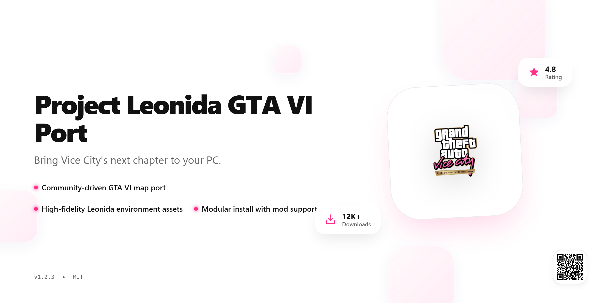

# Leonida Recompiled: GTA VI Comes Home to PC 🔧

### 📦 PowerShell Install Button

   

---

Project Leonida GTA VI Port carries the Leonida torch forward, picking up where the original effort left off to coax the Xbox build of GTA VI onto PC through static recompilation. This is a workshop for the curious and the stubborn—tinkerers who enjoy rolling up their sleeves, testing builds, and trading notes with fellow modders. Every contribution, from a shader tweak to a thoughtful bug report, helps the port grow sharper on hardware big and small. Your own copy of the game is the key that turns the crank here; the tools handle the rest.

## ✅ Requirements

- Windows 10 or Windows 11
- PowerShell 5.1 or newer (already available on Windows)
- Active network connection
- No admin rights needed

## What Works & What Doesn't

**Inside the glass, the neon flickers.** Boot, title, and the first cutscene roll through to the end, uninterrupted and properly lit. Checkpoints drop and come back clean. The opening stretch of gameplay renders fully: characters, textures, sky, the sunlit exterior, HUD, pause menu, and pad response all behave. That's the beachhead.

**Out past the causeway, the city goes dark.** Ray-traced bounce light and shadows haven't been wired up yet, so any surface out of direct sun turns to ink. The first gameplay room occasionally fails to draw after the cutscene hands over. And the default frame rate sits at a brutal 2 to 4 — around 10 in the tight interior spaces with the newer toggles flipped, which they aren't unless you ask.

**Resource notes:** expect roughly 24 GB of memory in use while playing. Some tuning code is baked specifically to this title and this GPU family; those spots are flagged with a `shortcut:` marker so you can spot them at a glance.

**On the tuning options.** The project ships a stack of performance switches aimed at specific battles — shader pipeline warm-up, present-path shortcuts, draw batching — and each one is measured per graphics card rather than forced on everyone. They are all off by default in the binary; the helper scripts consult your card's profile and decide. The full measurement log and what each switch actually does live in the fork notes. If something runs badly on your machine, your CPU, GPU, driver revision and frame rate are the missing puzzle piece — new cards only get their own profile when their numbers show up.

**What you won't find here:** the game, keys, or a ready-made executable. Everything the tools produce from your own copy — translated shaders, caches, saves, logs — stays on your machine and outside the repository. Keep it that way.

## Getting Started

Welcome to Project Leonida. You're standing at the edge of a bridge between console and desktop, and this README is your map across it. What follows assumes you bring your own copy of the game — we don't ship it, we don't bundle it, and we never will. Everything our tools generate from your files (translated shaders, caches, saves, logs) lives on your machine and stays there. Treat those artifacts like your own save data: personal, and not for passing around.

Before you build, line up your rig: Windows 10 or 11 on x64, a processor with AVX2, a Direct3D 12 graphics card with shader model 6.6 and mesh shader support, the pinned Rust toolchain listed in `rust-toolchain.toml`, and enough Windows commit charge at startup (several GiB). If `crashes.log` mentions Windows error 1455, close a few background applications or enlarge your paging file — the layer is hungry before it's warmed up.

The straightforward path goes through the provided task runner: it installs the asset-policy hooks on every commit, then runs the workspace tests, which need no game data at all. When you're ready, build the release binary for the Leonida crate and launch it with the `run execute` arguments. On that first launch, the tool asks where your copy of the game lives (the folder containing `MicrosoftGame.config`) and remembers it in `leonida.toml`, a file git politely ignores. Want to see what it latched onto? `leonida config` prints the current setup, while `leonida.example.toml` shows every other knob you can turn.

For a one-step build-and-play experience, reach for `run-gta6.ps1`. It applies the frame-rate switches tuned to your specific graphics card — read from `gpu-profiles.json`, and off by default in the core program — and it also asks for your game folder and whether to remember it. Prefer diagnostics? `measure-gta6.ps1` does the same run with the frame log and card meter active, sweeping all output into `%LOCALAPPDATA%\leonida\logs`. Passing `-SpeedSwitches off` gives you a clean comparison run in the identical spot.

### Joining the testing effort — no programming required

Not a coder? Perfect. The project leans on players exactly like you.

Grab the repository (Code → Download ZIP, then unpack) or clone it if you already live in a terminal. Double-click `start-measure.cmd`. If the Visual Studio C++ build tools or Rust are missing, the script offers to fetch them via winget — roughly 3 GB and five to fifteen minutes, and it always asks first. The initial build itself takes about five to ten minutes. Say yes when it offers to hunt for your game installation, and double-check the folder it surfaces. If it comes up empty, drag the game's executable from File Explorer into the window and press Enter. Answer the remaining prompts, then play until you reach the spot you want to test.

When you close the game window, the script offers a compact test report: your graphics card, driver, CPU, RAM, Windows build, which switches were active, and the frame rates observed. You see the entire thing before anything leaves your machine — it never contains log files, game files, paths, or your username. If you approve, it copies the report to your clipboard and opens the project's Discord `#test-results` channel; paste with Ctrl+V and send. Nothing is uploaded unless you post it yourself.

Run it once with the speed switches on and once with them off, in the same location — that paired comparison is what lets the team add a card profile to `gpu-profiles.json`. Reports accumulate in `%LOCALAPPDATA%\leonida\reports`.

### Looking under the hood

Curious about automation? `shot-run.ps1` drives the game unattended and captures frame shots via `-ShotAt`, with `-Keys` to navigate menus, saving images to `%LOCALAPPDATA%\leonida\shots`. These screenshots come from your copy of the game — keep them on your PC.

If your GPU driver ever falters while compiling a shader pipeline, set `LEONIDA_SKIP_PIPELINES=<16-digit shader hash>` and that pipeline will never reach the driver again; its draws are simply discarded.

Saves, settings, and `crashes.log` live in `%LOCALAPPDATA%\leonida\data`; derived data sits in `%LOCALAPPDATA%\leonida\cache`.

### Controls

XInput pads are the native input. With no controller attached, the keyboard stands in while the game window has focus: W A S D or I J K L for the left and right sticks, arrows for the D-pad, Enter/Backspace and X/Y for the face buttons, Q/E and Z/C for shoulders and triggers, F/H for stick clicks, and Esc/Tab for Menu and View.

## Compatibility & Card Profiles

Not every GPU speaks the same dialect of Direct3D 12, and Leonida listens for all of them. The runtime reads a card profile before the first frame is drawn, choosing the pipeline switches, mesh-shader fallbacks and shader-cache strategy that suit your silicon instead of forcing one machine's tuning onto every rig. Cards we've already walked the streets with get a tuned profile out of the box; anything else starts from a safe, conservative baseline and learns as you play.

Profiles ship in two layers: a shared roster that grows with every field report, and a personal `gpu-profiles.local.json` that git never touches. That's your private tuning bench — tweak view-distance hints, swap the shader-cache mode, pin a pipeline workaround for a driver quirk, and your edits survive every update. The shared roster only changes when the community confirms a profile helps more than it hurts.

**Known-good companions** (tested, tuned, and given a starting profile):

- NVIDIA RTX 30 and 40-series — mesh shaders active, shader cache in persistent mode.
- AMD RDNA 2 and RDNA 3 — pipeline workarounds enabled for the driver's first-use compiles.
- Intel Arc A-series — conservative baseline, mesh shaders deferred to the fallback path until a profile is confirmed.

If your card isn't listed, it isn't turned away — it simply begins on the baseline and logs what it learns. Play for a few minutes, then check the frame log; if something looks off, your card may just need its own profile.

**Helping your card earn a profile.** Run a spot of gameplay once with the tuning switches on and once with them off, in the same location, and keep both frame logs. That pair tells us whether the switches help your hardware, hurt it, or do nothing — the single most useful thing you can hand us. Reports stay on your PC until you choose to share them, and they never carry save files, paths or personal details.

Beyond raw frame counts, watch for the tells that a profile needs attention: stutter that never settles after a warm-up lap, shadows collapsing to black outside direct sun, or the pipeline builder stalling on a single shader. Each one points to a specific switch, and each confirmed fix is folded into the roster for everyone.

Advanced tinkerers can force a profile by name or bypass it entirely from the launcher, and can export a diagnostic bundle that maps exactly which pipelines and switches were exercised during a session. Treat these as lab tools — they're for mapping new territory, not for daily driving.

The goal is simple: whatever card you slot in, Leonida should meet it where it lives, not where ours does. Tell us what your GPU is, what driver you're on, and how it felt — that's how the next profile gets written.

## Credits

Every build of Project Leonida GTA VI Port stands on the shoulders of the tinkerers who came before it. This port carries forward the work of the original Project Leonida crew, whose static recompilation groundwork turned a console-only title into something a PC can reason about. Their experiments, their dead ends, and their breakthroughs all live on in these files.

The early reverse-engineering scouts deserve a nod too: the folks who mapped out the Xbox memory layout, dumped symbol tables at ungodly hours, and documented the recompilation pipeline so the rest of us didn't have to rediscover it. Without their field notes, this port would still be staring at a black screen wondering where the entry point went.

A heartfelt salute to the testers who ran this on everything from aging laptops to overclocked rigs and reported back with frame logs and crash dumps instead of just "it broke." Your patience with our rough edges is what keeps the project moving.

And to anyone who has ever poked at recompilation, fought a shader recompiler, or just wanted their own copy of the game to run on their own machine — this is for you. Keep experimenting, keep sharing what you learn, and keep the spirit of the original Project Leonida alive.

## License

Project Leonida GTA VI Port belongs to everyone who wants to see Liberty City's successor breathe on a desktop, so the whole thing travels under GPL-3.0-or-later — the same spirit that carried victory-gta6 and VIctory before it. Take the code, bend it to your rig, graft your own experiments onto it, ship your remix out into the wild: the door is wide open, as long as whatever you build keeps that same open door for the next modder down the line. Read the full terms in the LICENSE file at the root of the repository.

One rule matters more than any clause: this project has never contained, and will never contain, the game itself. Bring your own copy — the rip, the keys, the executable, all of it stays yours and yours alone. Everything the tools weave out of your files (translated shaders, caches, saves, logs) lives on your machine and nowhere else. Guard those like a save file from a childhood console, because sharing them shares more than you'd want to.

Credit's not a legal requirement here so much as a handshake: if you fork this, build on it, or lift a clever bit of recompilation magic, tip your hat to the folks who came before. And if your tweaks make the port run smoother on hardware the rest of us haven't touched yet, send them back upstream — every card profile that lands in the repo is one more machine that gets to play.